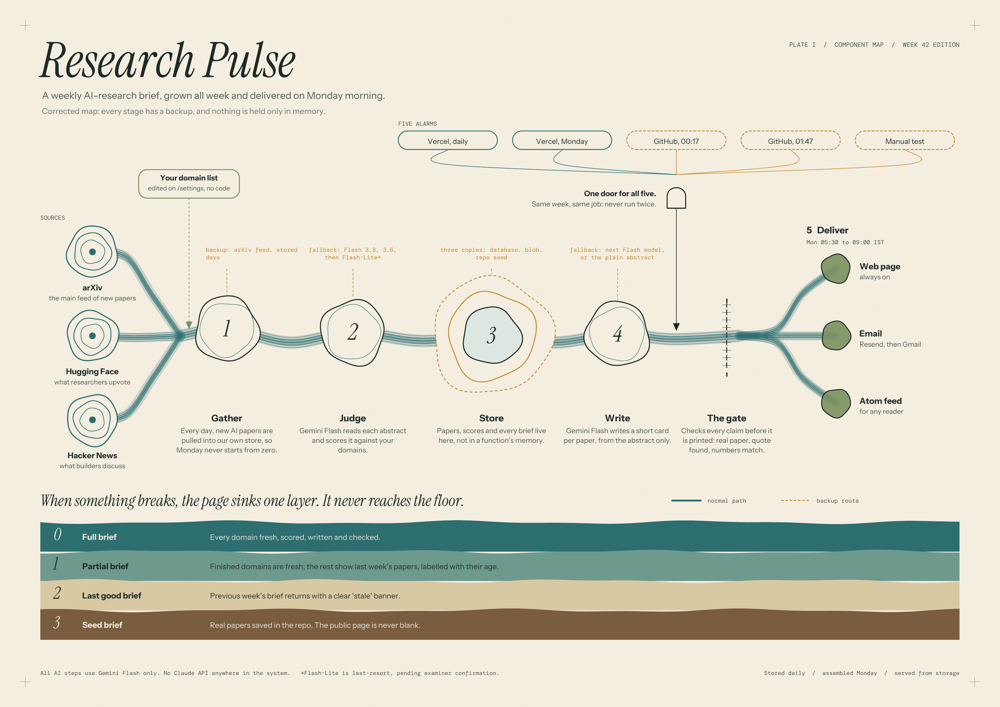

# Research Pulse

A weekly brief of significant AI/ML papers, organised by domain, delivered Monday morning (IST), readable in under ten minutes. The domain list is edited on `/settings`, no code change.



## How it works
Daily, new arXiv papers are stored (`/api/cron/daily`). On Monday the weekly job assembles a brief from stored data: Gemini Flash scores abstracts, writes short cards from the abstract only, and a code-level gate checks every claim (quote must exist in the abstract, numbers must match). The brief is published to the database, mirrored to a blob snapshot, and emailed. The website only ever reads stored data and degrades: full brief -> partial -> last good brief with a stale banner -> committed seed brief.

All AI steps use Gemini Flash. No other model provider is used.

## Run it
```bash
npm install && cp .env.example .env.local   # fill in keys
# create a Neon project, set DATABASE_URL, then apply the schema:
#   psql "$DATABASE_URL" -f db/migrations/0001_init.sql
npm run dev
npm test
```

## How to verify the Monday automation
- `/status` lists the last 20 trigger events (which alarm arrived: vercel, github, manual) and every brief run.
- `vercel.json` defines the Monday job in the 00 UTC hour (05:30 to 06:29 IST) because Hobby crons fire anywhere inside the scheduled hour; the daily job at 02 UTC is a catch-up; GitHub Actions adds two backups. All call the same idempotent route.
- Grader test mode: `POST /api/admin/run-now?mode=test` with header `x-examiner-token` runs the pipeline as a dry run (no publish, no email). One run per hour.

## Limits (honest list)
Abstract-only summaries, same-family judge (Gemini scores and Gemini writes, so errors can correlate), attention signals favour famous labs, free-tier Gemini limits are unpublished, Hobby crons are not exact.
