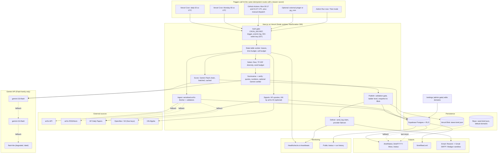

# Hardening Research Pulse: store everything, trigger everywhere, degrade gracefully

**Date of research: 11 October 2026 (Sunday). Evidence legend:** notes are cited as **[S]** sources_and_redundancy, **[V]** vercel_scheduling_persistence, **[G]** gemini_flash_reliability, **[R]** ranking_grounding_injection, **[D]** delivery_and_monitoring. Web sources are linked inline. "UNVERIFIED" means the notes say it was not confirmed from a fetched primary source. "TESTED" means a note author ran the request on 2026-10-11 from a shared sandbox IP. Estimates marked "(my estimate)" are this report's arithmetic or judgement, not sourced.

---

## 1. Verdict

The current component map is a clean happy-path pipeline with **no memory and no second chance**. Every stage assumes one trigger fires on time, arXiv returns the newest papers, Gemini answers within an unpublished quota, Resend can email the consultant, and Supabase is awake. Each of those assumptions is contradicted by documentation or by a test in the notes. The single most damaging design choice is the weekly "one run does everything" shape: if any link fails on Monday, the examiner sees an empty site and Kavita gets nothing. The fix is structural, not cosmetic. Persist raw and derived data, ingest daily, make the Monday step a short idempotent "assemble and deliver" job that many independent triggers can call, and let the website read only from stored data through a four-rung fallback ladder that ends in a committed seed brief. All of this stays inside the exam rules: Gemini Flash-family models only (no Claude API anywhere), Vercel hosting, a public URL, a GitHub repo and a Components Map.

**Top five loopholes by severity** (full register in section 2):

1. **No durable serving layer or fallback (L01).** If the page needs live calls, or Supabase Free pauses after about 7 days of low activity, a grader sees an empty or erroring page. A weekly-only workload sits exactly at the pause threshold ([Supabase pausing](https://supabase.com/docs/guides/platform/free-project-pausing.md); [V]).
2. **A single, unreliable trigger (L02).** GitHub `schedule` runs have been reported 8 to 14.5 hours late and skipped ([GitHub #201738](https://github.com/orgs/community/discussions/201738)), public-repo schedules auto-disable after 60 days idle, and Vercel never retries a failed cron and may deliver duplicates ([Vercel cron docs](https://vercel.com/docs/cron-jobs/manage-cron-jobs)).
3. **The "last 7 days" arXiv window is wrong on a Monday (L03).** The API filters only on submission time and newest papers are invisible until announced. On Sunday 11 Oct a window of 9 to 11 Oct returned 0 results (TESTED, [S]). A Monday run silently loses 2 to 3 days and mislabels the rest.
4. **Gemini is an unquantified single point of failure (L04).** Free-tier limits are unpublished (one forum post reports about 20 requests/day for `gemini-3.8-flash`, unverified, [forum](https://discuss.ai.google.dev/t/gemini-3-8-flash-free-tier-20-rpd-is-too-limited-for-practical-evaluation/180609)), 503 "high demand" lasted hours to days in August 2026, and model IDs churn (3.5 and 3.7 Flash were deprecated on 8 Oct 2026) ([Deprecations](https://ai.google.dev/gemini-api/docs/deprecations); [G]).
5. **Email cannot reach the consultant without a verified domain (L05).** Resend returns HTTP 403 "You can only send testing emails to your own email address" for unverified senders ([Resend errors](https://resend.com/docs/api-reference/errors)). One provider, one channel, no failover.

**Just missed the top five:** a Vercel Deployment Protection login wall that hides the site from graders (L06), the 300-second Hobby function ceiling with per-domain fan-out that also breaks arXiv's 1 request per 3 seconds rule (L07), and a validation gate that checks only that an arXiv ID exists and not that the summary is faithful or uninjected (L08, L09).

### Exam-requirement traceability (the hardened design still satisfies every rule)

| Exam / brief requirement | How the revised design satisfies it |
|---|---|
| Weekly brief, scans 8 to 10 domains | Daily ingest of broad categories, domain assignment in code plus one Gemini field; Monday assemble step |
| Significant papers, not press | Scored on abstract merit, HF/HN attention (signal only), artefacts; absolute floor, honest "quiet week" |
| Context per paper (read vs bring to client) | Fixed card: finding, why it matters, evidence type, caveat, action tag |
| Organised by domain | `brief_items` grouped by domain; one home domain per paper |
| Delivered Monday morning | Monday 00:00 to 00:59 UTC job (05:30 to 06:29 IST) plus independent secondary triggers and a hard backstop (section 4) |
| Under ten minutes | Global word budget enforced in code (about 1,800 to 2,000 words), reading time printed |
| Domains adjustable without code | `domains` table edited on a gated `/settings` page; ingest reads it each run |
| Live external data and works with some data at submission | Live arXiv/HF/HN plus stored history plus committed seed brief of real papers |
| All AI = Gemini Flash, no Claude | Pinned Flash-family chain; no embeddings or other AI models (TF-IDF in code instead); no Anthropic component |
| Vercel deploy, public URL, GitHub repo, Components Map | Production alias submitted; Mermaid map in section 3 |

---

## 2. Loophole register

Likelihood (L) and Impact (I): H high, M medium, Lo low. Ordered by severity (L x I, then grader visibility). "Src" gives the note(s) that raised it.

| ID | Component | What breaks | L | I | Fix | Src |
|---|---|---|---|---|---|---|
| L01 | Storage and serving | Page or run depends on live calls or one DB. Supabase Free pauses after about 7 days of low activity, has no automatic backups. Empty page at grading | M-H | Critical | Page reads stored data only: DB, then Blob snapshot, then committed seed. Daily keep-alive with a real `select`. Weekly JSON export | V, S, G |
| L02 | Scheduler | Sole GitHub cron: reported 8 to 14.5 h late, skipped days, 60-day idle auto-disable, default-branch only. Vercel: no retry, best-effort, possible duplicates, no log if delivery fails | H | Critical | Vercel Cron primary, GitHub Actions secondary at off-peak minutes, daily catch-up cron, optional external pinger, all calling one idempotent route | V, D |
| L03 | arXiv window | `submittedDate` only; newest 2 to 3 days invisible until announcement. Window 9 to 11 Oct returned 0 (TESTED). Overlaps next run. `lastUpdatedDate` silently rewritten to `submittedDate` (TESTED) | H | H | Daily ingest, announcement-aligned window defined by `first_seen_at`, filter on `published`, version-aware dedupe | S |
| L04 | Gemini | Free quota unpublished (about 20 RPD for 3.8 Flash reported once, unverified); 503 outages of hours to days; 429 daily vs per-minute; no budget, no fallback; in-memory work lost at timeout | H | Critical | Call budget, batching, spread scoring over days, retry then model chain, cache by paper+prompt version, persist per step | G |
| L05 | Email | Resend 403 to non-owner without verified domain; one provider; 100/day cap; accepted is not delivered; Brevo needs approval and a domain; SendGrid free plan gone | H if no domain | Critical | Provider interface with failover (Resend, then Gmail SMTP or Mailgun sandbox), plus web and Atom feed; domain decision (section 11) | D |
| L06 | Deployment Protection | Preview or hash URL, or a team default of "All Deployments", puts a Vercel login in front of graders. Automation hitting a protected URL gets HTML, not the job | M | Critical | Submit the production alias, check logged out, verify team default, never use `VERCEL_URL` as public URL | V |
| L07 | Compute shape | One invocation per domain: Hobby cap 300 s (504 leaves half-written brief); parallel invocations break arXiv's single-connection 1 req/3 s rule; concurrent Gemini bursts | H | H | State-table worker with leases and a 240 s time budget; one serialised arXiv fetcher; concurrency 2 to 3 for Gemini | V, S, G |
| L08 | Validation gate | Checks only ID-in-set, schema, caps. Structured output guarantees syntax not truth. Model can emit a wrong but real ID. Word limits can truncate caveats | H | H | Code joins ID/title/URL; quote-substring and number checks; optional Gemini verifier; schema-level length limits and regenerate | R, G |
| L09 | Prompt injection | Abstract, title, comments and HN titles are attacker-controlled. Real hidden-prompt cases in 2025 ([arXiv 2507.06185](https://arxiv.org/abs/2507.06185)). Obfuscation defeats keyword scans | M | H | No tools; datamarking; scan and flag; separate scoring and summary calls; plain-text rendering; code-built links | R |
| L10 | Settings and abuse | Public `/settings`: defacement, prompt injection via domain names, anonymous Gemini quota burn. Hobby has no platform password | H | H | App-level admin gate, strict validation, settings never trigger processing, run-now cooldown, audit trail | V |
| L11 | arXiv response validation | HTTP 200 with an `Error` entry (TESTED), empty feeds, `start` past total. Naive parser ingests a fake paper or an empty week | M | H | Reject Error titles, check totalResults vs 4-week median (suspicious-empty rule), follow redirects, keep last good | S |
| L12 | Idempotency | Duplicate or concurrent triggers double-spend Gemini and send two emails; no lock | H | M-H | ISO-week key in IST, unique constraints, atomic lease claims, `send_log` unique on (week, recipient, channel) | V, D |
| L13 | Coupling | Generate and send in one Sunday/Monday job; failure means no email, no stale fallback | H | H | Separate assemble from deliver; send last good brief with STALE banner if current week missing | D |
| L14 | Observability | Hobby runtime logs last 1 hour; missed cron leaves no log; failure invisible by 07:30 | H | M-H | `trigger_events`, `brief_runs`, `source_health` in DB; public `/status`; Healthchecks.io heartbeat | V, D |
| L15 | Model IDs | 8 Oct deprecations auto-route silently (score drift); preview IDs vanish with 2 weeks notice; 2.5 gated to prior users (404 for new projects); 3.1 Flash-Lite shuts 7 May 2027 | H | M-H | Pinned IDs in one config, log `modelVersion`, skip to next model on 404, re-check docs the week of submission | G |
| L16 | Exam wording: "Gemini Flash" | Flash-Lite as fallback may not count. No source defines the exam term | M | H | Full Flash first; Flash-Lite labelled in UI as degraded mode; ask the examiner | G |
| L17 | Free-tier data terms | Free-tier prompts and outputs used to improve Google products and may be human-read; EEA/UK/CH clients must use paid services ([Terms](https://ai.google.dev/gemini-api/terms)) | M | M | Send only public abstracts; consider Tier 1 with spend cap; document the choice | G |
| L18 | Hobby cron timing | Fires anywhere in the scheduled hour; `0 1 * * 1` can fire at 07:29 IST, missing a 07:00 target before any processing | H | M | Schedule in the 00 UTC hour; define the delivery window explicitly | V |
| L19 | Ranking quality | Pointwise 1 to 10 scores compress and tie; position, verbosity, self-preference biases (2023-era judges); no gold set, no stability metric | H | M | Anchored rubric, percentile within domain, absolute floor, order-swapped listwise on top candidates, small gold set | R |
| L20 | Attention signals | HN sparse and biased to famous labs (unquantified); no paper-ID join; HF Daily Papers undocumented, self-submitted, empty on weekends; Papers with Code shut down July 2025 | H | M | Treat HN/HF as optional signals, neutral value when missing, match HN by arXiv ID/URL | S, R |
| L21 | Query design | Keyword false positives ("RAG", "agent", "industrial"); >1,000 results per 7-day category window (cs.AI about 1,934 in 10 days, TESTED); default `max_results` silently truncates | H | M | Fetch broad categories once with paging (pages <= 200), assign domains locally | S |
| L22 | Holidays and gaps | Oct 12, Nov 26, Dec 25/29/31 deferred-mailing dates; Fri/Sat no announcements. Thin windows look like outages | M | M | Expectation table; suspicious-empty rule aware of holidays | S |
| L23 | Dedupe | Cross-lists land in several domains; revised versions (v2) recur; same paper repeated across weeks | H | M | Base-ID primary key, one home domain, `featured` table, exclude revisions unless `published` is in window | S, R |
| L24 | Reading-time cap | 3 to 5 papers x 8 to 10 domains x 70 words = 1,700 to 3,500 words; cap and ten-minute requirement can conflict | H | M | Global word budget wins over per-domain cap; drop lowest-ranked items; show reading minutes | R, D |
| L25 | Time zone | Hard-coded UTC; ISO-week year boundary (2026 has 53 ISO weeks, my check); arXiv ET shifts one hour in UTC after 1 Nov (inference) | M | M | Week key in IST via IANA zone; deliberate window definitions | D, S |
| L26 | Keyless fallbacks | S2 returned 429 and OpenAlex "$0 remaining" on shared IP (TESTED); DBLP bot-challenge HTML and OpenReview 403 (TESTED); RSS about 24 h cached; OAI-PMH returned a 3.5-week-old cached reply (TESTED) | H | M | Free keys only; skip DBLP/OpenReview/PwC; RSS only for latest day | S |
| L27 | Secrets and RLS | RLS off plus exposed key equals public read/write; secret in `NEXT_PUBLIC_`; CRON_SECRET with newline fails silently; committed `.env`; leaked Gemini key revoked | M | H | RLS on every table, server-only secrets, `.env.example`, rotation grace, pre-submission scan | V, G |
| L28 | Examiner verifiability | Cannot wait a week to see Monday automation; no run history | H | M | `/status` with trigger source rows, protected run-now/test mode, evidence screenshots | D |
| L29 | Platform constraints | Hobby cannot import GitHub-organisation repos; non-commercial only; crons only on Production; 3xx ends a cron invocation; rollback reverts cron definitions | M | M | Personal-account repo, no ads/payments, `trailingSlash` check | V |
| L30 | Beta dependencies | Vercel Queues (beta), `queue/v2beta`, pg_net (beta), Workflow SDK (beta-numbered) may change | M | M | Avoid; use state table plus `after()` | V |
| L31 | Gemini output handling | Thinking tokens count toward `max_output_tokens`; low cap gives truncated or empty JSON; `minimal` thinking errors on 3.8; empty candidates on safety block | M | M | `thinking_level: low`, generous output cap, finishReason check, id-keyed repair | G |
| L32 | Privacy | Recipient address leaking via public page, logs or client bundle; no unsubscribe | Lo-M | M | Server-only recipient table, signed unsubscribe, masked display | D |

### Where the notes conflict or a claim is unverified

| Topic | Conflict or gap | Resolution used here |
|---|---|---|
| Generation timing | [D] suggests generating Sunday about 18:00 UTC; [S] suggests Monday about 10:00 UTC or Tuesday | Both are wrong for this brief. Sunday 18:00 UTC precedes the Sunday 20:00 ET announcement, and Tuesday misses "Monday morning". Design uses daily ingest plus Monday 00 UTC assemble |
| Hourly delivery crons | [D] proposes 24 hourly cron entries to hit 07:00 local; [V] flags that even two daily entries on Hobby are UNVERIFIED | One recipient in IST needs no hourly grid; use few entries and test deploy acceptance |
| Judging effort | [R] proposes 3 samples plus pairwise (56 to 132 calls per domain); [G] budgets about 80 calls per run | Calls win. Single batched pointwise pass, listwise ordering only for top candidates (section 6) |
| Temperature | [R] proposes low temperature; Gemini 3 guide says keep 1.0, and the 3.8 migration list says remove `temperature`, `top_p`, `top_k` ([latest model](https://ai.google.dev/gemini-api/docs/latest-model)); `temperature: 0` acceptance on 3.8 UNVERIFIED | Do not set sampling parameters; get repeatability from caching and rubric |
| Free-tier numbers | About 20 RPD (3.8 Flash) and about 500 RPD (Flash-Lite) are single forum posts, 2.5 Flash cut is third-party ([agentdeals](https://agentdeals.dev/gemini-api-pricing-changes), dates inconsistent) | Treat as planning guesses; read live limits at aistudio.google.com/rate-limit |
| arXiv "new rate policy" | A blog claims an Oct 2026 policy change without numbers; headlines concern submission caps | Keep 1 request per 3 s; monitor info.arxiv.org ([blog](https://www.kunalganglani.com/blog/arxiv-rate-limit-policy), unverified) |
| Oct 12 holiday | [S] says the ToU page lists Oct 12 as a deferred-mailing date but does not say no announcement occurs | Treat as possibly one fewer batch in the following brief; observe and log |
| arXiv API visibility after announcement | Docs say new items appear "at midnight after processing" (ambiguous); lag after Sunday 20:00 ET not measured | Measure tonight (section 11); probe-and-wait logic in section 4 |
| Vercel cron and protection | Whether Vercel's own cron passes Deployment Protection is not documented in the fetched pages | Keep production unprotected (or Standard) and test |
| 60-day GitHub rule | Not confirmed that Actions runs count as repository activity | GitHub is secondary only |
| Count of hidden-prompt papers | 17 (Nikkei) vs 18 (Nature, Lin) across outlets | Cite as "about 17 to 18" |
| Resend `onboarding@resend.dev` | Recipient-limit wording not fetched; the 403 error text is confirmed | Plan for owner-only delivery without a domain |

---

## 3. Revised redundant architecture

### 3.1 Design principles

1. **Store first, serve from store.** The website never calls arXiv, Gemini or HN at view time ([S] section 5).
2. **Split by speed of change.** Daily jobs gather and pre-score; the Monday job only assembles, summarises, validates, publishes and sends.
3. **One idempotent worker, many triggers.** Every trigger calls the same routes, which claim leased rows in a state table. Duplicates become no-ops and missed triggers are caught by the next one ([Vercel guidance](https://vercel.com/docs/cron-jobs/manage-cron-jobs)).
4. **Code owns facts, Gemini owns judgement.** IDs, titles, URLs, dates and counts come from fetched records; Gemini returns scores and prose only.
5. **Never block on optional signals.** HN, HF, S2 and OpenAlex failures lower detail, not availability.

### 3.2 Component-by-component: primary, fallbacks, failure trigger

| Component | Primary | Fallback(s) in order | Failure trigger (switch condition) |
|---|---|---|---|
| Scheduler | Vercel Cron: daily job (02:xx UTC) and Monday assemble job (00:xx UTC), Production only | 1) GitHub Actions at off-peak minutes (Mon 00:17 and 01:47 UTC) plus `workflow_dispatch`; 2) the daily Vercel job doubles as catch-up; 3) optional external pinger or Supabase pg_cron (availability on Free UNVERIFIED) | No `trigger_events` row of source `vercel` by 00:45 UTC Monday, or brief status not `published` by the catch-up |
| Orchestration | State-table worker with leases and 240 s budget | `after()` self-continuation; next trigger resumes from the table | Lease expired (8 min) or budget exhausted |
| arXiv ingest | arXiv API, serialised, >= 3.1 s spacing, descriptive User-Agent, broad category queries paged <= 200 | arXiv RSS/Atom for the latest day; stored previous days; HF Daily Papers per weekday (undocumented, optional); OpenAlex or S2 **with free keys** | HTTP non-2xx, timeout 10 s after 3 retries (5/20/60 s plus jitter), `Error` entry, HTML body, totalResults 0 or < 25% of 4-week median outside expected-empty days |
| Attention signals | HF daily papers (upvotes, linked repos) and HN Algolia by arXiv ID | Drop signal; neutral percentile 50 and "no data" tag | Any error; never blocks publish |
| Persistence | Supabase Postgres via supabase-js over HTTPS (or pooler port 6543, `prepare:false`, `max:1`) | Vercel Blob `latest-brief.json` written after each publish; committed `data/seed-brief.json` | Read error, timeout or paused project |
| LLM scoring and summary | `gemini-3.8-flash`, `thinking_level: low`, JSON schema + Zod | `gemini-3.6-flash`, then `gemini-3.5-flash-lite`, then `gemini-3.1-flash-lite` (labelled, subject to examiner OK) | 3 retries per model on 408/429-rate/5xx; daily-quota 429 or 404 skips immediately; 400/402/403 never retried |
| Validation gate | Deterministic code checks plus schema | Drop or regenerate once, then drop item and flag | Any check fails twice |
| Web | Next.js pages reading DB | Blob snapshot, then seed brief, banner states | DB read error or stale data |
| Email | Resend on verified domain (if available) | Gmail SMTP app password (no domain needed), or Mailgun sandbox to authorised recipients; web and Atom feed always available | 403/429/5xx/timeout; bounce webhook |
| Settings | Gated `/settings` writing `domains` | Committed default domain list as reset target | Validation failure or bad edit (revert from `settings_history`) |
| Monitoring | Healthchecks.io heartbeats (generation and delivery) plus public `/status` | Better Stack free heartbeat or uptime pings on `/api/health` | No ping within schedule plus grace |
| Seed | `data/seed-brief.json` of real cached papers | none (last resort) | Everything above failed |

### 3.3 Degradation ladder

| Rung | Name | What the reader sees | Trigger |
|---|---|---|---|
| 0 | Full brief | All domains, fresh, scored, summarised, verified | All steps succeeded for current week |
| 1 | Partial brief | Completed domains from this week; each failed domain shows last week's items labelled with age, or "not updated this week: reason". Sub-mode "AI-light": if Gemini is down but sources are up, show papers ranked by attention and artefact signals with truncated abstracts and a banner | At least one domain done and others failed after 3 attempts, or Gemini chain exhausted |
| 2 | Last good brief with staleness banner | Previous published brief with "Generated <date>; this week's run failed (reason code)". Fresh <= 8 days no banner; 8 to 15 days banner ([S]) | No domain completed for current week, or DB reachable but run failed |
| 3 | Committed seed brief | Real cached papers labelled "offline snapshot" | DB and Blob unreadable, or first deployment before any run |

Email follows the same ladder: send rung 0 or 1 normally; if only rung 2 is available at the delivery deadline, send it with subject marker "[stale]"; never send a half-written or over-budget brief ([D]).

### 3.4 Component map (paste into the Components Map document)



Text version for a one-page document: Triggers (Vercel Cron x2, GitHub Actions x2, optional pinger, admin run-now) feed one authenticated route layer that logs every arrival, then a leased state-table worker runs Ingest, Signals, Score, Select, Summarise and Verify, Publish, Deliver. Sources fall back arXiv API to RSS to HF to OpenAlex/S2. Models fall back 3.8 Flash to 3.6 Flash to Flash-Lite. Storage falls back Postgres to Blob to repo seed. Email falls back Resend to Gmail SMTP or Mailgun sandbox, with web and Atom as non-email channels. Heartbeats and `/status` observe everything.

---

## 4. Schedule and time-window design

### 4.1 Reference facts

- arXiv announces Sunday to Thursday at 20:00 ET; submissions cut off at 14:00 ET. Thursday 14:00 to Friday 14:00 is announced Sunday 20:00; Friday 14:00 to Monday 14:00 is announced Monday 20:00; there are no Friday or Saturday announcements ([arXiv availability](https://info.arxiv.org/help/availability.html)).
- In US daylight time (until 1 Nov 2026), 20:00 ET is **00:00 UTC the next day** (my conversion). After 1 Nov 2026 the batch lands at 01:00 UTC (inference; 1 Nov is a Sunday, checked).
- On Sunday 11 Oct about 17:13 UTC the newest cs.AI paper by `submittedDate` was published 8 Oct 17:59 UTC and the 9 to 11 Oct window returned 0 (TESTED, [S]).
- 07:00 IST is 01:30 UTC; IST has no DST ([V]).

### 4.2 Resolving tension (a): the newest batch and window labels

**Decision:** a brief is defined by *announcement batches*, not by calendar submission dates. A weekly brief (key `YYYY-Www`, week of the Monday delivery in IST) covers the five batches announced between the previous Monday-evening ET announcement and the Sunday-evening ET announcement:

| Batch announced (ET) | UTC (EDT) | Submissions covered (ET) |
|---|---|---|
| Mon 20:00 | Tue 00:00 | Fri 14:00 to Mon 14:00 |
| Tue 20:00 | Wed 00:00 | Mon 14:00 to Tue 14:00 |
| Wed 20:00 | Thu 00:00 | Tue 14:00 to Wed 14:00 |
| Thu 20:00 | Fri 00:00 | Wed 14:00 to Thu 14:00 |
| Sun 20:00 | Mon 00:00 | Thu 14:00 to Fri 14:00 |

For W42 (Monday 12 Oct) that is announcements from Tue 6 Oct 00:00 UTC to Mon 12 Oct 00:00 UTC, or papers submitted roughly Fri 2 Oct 14:00 ET to Fri 9 Oct 14:00 ET. The brief header prints exactly this: "Papers announced 6 to 12 Oct 2026 (submitted about 2 to 9 Oct). Papers announced after Monday 00:00 UTC appear next week."

**Mechanics:**
1. The daily job queries `submittedDate` with a generous overlap (last 5 days) per broad category, upserts by base arXiv ID, and records `first_seen_at` and `announce_batch`. Papers become visible only once announced, so `first_seen_at` is a faithful proxy for announcement (inference).
2. Window membership is `first_seen_at` between the previous cut-off and this cut-off, with a sanity filter on `published` (v1 date) within 14 days. Revisions (id version above v1 with old `published`) are excluded.
3. **Late items roll forward.** If a batch is ingested late, or the Sunday batch is not visible at assemble time, those papers have a later `first_seen_at` and land in the next brief, flagged "carried over from last week" if their `published` precedes the window.
4. **Probe-and-wait:** the Monday job first checks whether the newest visible `published` is at least Friday 13:00 ET. If not, it sets status `waiting_batch`, does not publish, and relies on the 01:47 UTC GitHub run and the 02:xx UTC daily catch-up to retry. At the catch-up it publishes regardless, labelling the missing batch in the header.
5. Holiday expectation table (Oct 12, Nov 26, Dec 25, 29, 31 are listed as deferred-mailing dates; whether announcements are skipped is not stated by the page) feeds the suspicious-empty rule so thin windows are labelled "holiday week" rather than treated as outages ([S]).
6. **Bootstrap:** the first deployment runs a backfill of the last 7 days of announced papers (up to 8 Oct 17:59 UTC visible today) so the first brief is real.

The visibility lag between the Sunday 20:00 ET announcement and API availability is not documented. Section 11 gives the measurement.

### 4.3 Resolving tension (b): which UTC hour, and secondary triggers

Hobby crons run at most once a day and may fire anywhere inside the specified hour ([Vercel cron pricing](https://vercel.com/docs/cron-jobs/usage-and-pricing); [Managing cron jobs](https://vercel.com/docs/cron-jobs/manage-cron-jobs)). A cron in the 01 UTC hour can fire from 06:30 to 07:29 IST. **Use the 00 UTC hour for the Monday job** (`0 0 * * 1`, fires 00:00 to 00:59 UTC, which is 05:30 to 06:29 IST), leaving at least 30 minutes of margin before 07:00 IST for processing. The daily job uses `0 2 * * *` (02:00 to 02:59 UTC, 07:30 to 08:29 IST), safely after every batch.

**Delivery commitment (my definition, to state in the README):** target publish by 07:00 IST; hard backstop publish and send by 09:00 IST on Monday; "Monday morning" in the submission means 05:30 to 09:00 IST.

| Time (UTC) | IST | Trigger | Action |
|---|---|---|---|
| Daily 02:00 to 02:59 | 07:30 to 08:29 | Vercel Cron `/api/cron/daily` | Ingest (5-day overlap), signals, pre-score backlog within daily budget, keep-alive write, heartbeat ping, retry failed rows |
| Mon 00:00 to 00:59 | 05:30 to 06:29 | Vercel Cron `/api/cron/weekly` | Final ingest, probe, score new items, select, summarise, verify, validate, publish, deliver |
| Mon 00:17 | 05:47 | GitHub Actions (secondary 1) | Same route; no-op if published; resumes if leased rows expired |
| Mon 01:47 | 07:17 | GitHub Actions (secondary 2) | Retry for `waiting_batch` or failed domains |
| Mon 02:00 to 02:59 | 07:30 to 08:29 | Daily cron | Catch-up; forces publish of best available brief; delivers (stale marker if needed) |
| Mon 03:30 | 09:00 | Healthchecks deadline | Alert owner if delivery heartbeat missing |
| Tue 00:00 | 05:30 | arXiv batch for next week | Picked up by Tuesday 02:xx daily run |

**Idempotent key:** `week_key = ISO year-week computed in Asia/Kolkata` (W42 for 12 Oct 2026; 2026 has 53 ISO weeks). Unique constraints on `brief_runs(week_key)`, `domain_runs(week_key, domain_id)` and `send_log(week_key, recipient_id, channel)`. Claim work with an atomic `UPDATE ... SET status='running', lease_expires=now()+8 min WHERE status='pending' OR (status='running' AND lease_expires<now()) OR (status='failed' AND attempts<3) RETURNING`. A lease longer than the 300 s function ceiling means a dead worker is retaken ([V]).

Routes accept `GET` (Vercel cron) and `POST` (others), compare `Authorization: Bearer <secret>` in constant time, set `dynamic = 'force-dynamic'`, return 202 quickly and continue via `after()`. Cron needs a Production deployment, no redirects, and `CRON_SECRET` free of newlines ([Troubleshooting cron](https://vercel.com/kb/guide/troubleshooting-vercel-cron-jobs)). Whether two separate Hobby cron entries deploy is UNVERIFIED in [V]; confirm with a test deploy. GitHub runs only from the default branch, can be delayed at the top of the hour, and auto-disables after 60 idle days ([GitHub docs](https://docs.github.com/en/actions/reference/workflows-and-actions/events-that-trigger-workflows)), so it is secondary by design; add an occasional commit if the repo will sit idle.

### 4.4 Resolving tension (c): Gemini quota versus 40 to 50 calls per week

- **Facts:** limits are per project (RPM, TPM, RPD), RPD resets at midnight Pacific, exact free numbers are not published ([Rate limits](https://ai.google.dev/gemini-api/docs/rate-limits)). A forum post reports about 20 RPD for 3.8 Flash and about 500 RPD for Flash-Lite; both unverified. Free-tier content is used to improve Google products ([Pricing](https://ai.google.dev/gemini-api/docs/pricing); [Terms](https://ai.google.dev/gemini-api/docs/terms)).
- **Per-run call budget (my estimate, from [G] arithmetic):** hard ceiling about 80 calls per run and about 150 per week including re-runs, tracked in an `llm_budget` table and checked before every call; exceeding it publishes partial.

| Job | Calls (estimate) | Basis |
|---|---|---|
| Daily pre-scoring (Tue to Fri, Sun) | 5 to 10/day | about 50 to 100 new domain-matched abstracts/day in batches of 8 to 12 |
| Monday: score Sunday batch | 8 to 10 | same batching |
| Monday: order top candidates | 0 to 10 | one listwise call per domain, optional |
| Monday: summarise | 6 to 10 | about 24 to 40 items, 4 to 5 per call |
| Monday: verify | 3 to 5 | one per 10 items, optional |
| Retry allowance | +30% | |
| **Weekly total** | **about 60 to 100** | within the ceiling |

- **Spread across days:** pre-score on Tue to Fri so the Monday step is about 20 to 35 calls. Scores are cached by (arxiv_id, prompt_version) and never recomputed.
- **If the free cap is really about 20 RPD on full Flash:** daily scoring fits (5 to 10), but Monday would not. Then either (i) enable Tier 1 billing with a spend cap (cost is cents: input $0.75 and output $3.75 per million tokens through 2026, [Pricing](https://ai.google.dev/gemini-api/docs/pricing); my estimate under $1/week), or (ii) rely on the fallback chain consuming separate per-model quotas (per-model separation is an inference, not confirmed), or (iii) pre-summarise shortlisted papers on Friday and Sunday so Monday only publishes.
- **Data-use terms:** abstracts are public, so privacy exposure is low, but free-tier terms require Paid Services for API clients made available to users in the EEA, Switzerland or UK ([Terms](https://ai.google.dev/gemini-api/terms)), and an examiner may be there. Recommended: Tier 1 with a small prepay or spend cap, key restricted to the Generative Language API, spare key stored separately. This is a decision for the student (section 11), because the exam text on cost is not in the notes.

### 4.5 Resolving tension (d): Resend free tier without a domain

Resend Free allows 3,000 emails/month, 100/day and 3 custom domains ([pricing](https://resend.com/pricing)), but without a verified domain it can only send to the account owner ([errors](https://resend.com/docs/api-reference/errors)). Options in order:

| Situation | Plan |
|---|---|
| Student has or buys a domain | Resend primary on a verified (sub)domain with SPF and DKIM, DMARC `p=none`; Brevo or Gmail SMTP fallback |
| No domain, recipient is the student/examiner demo address | Resend to the account-owner address works for the demonstration; set `recipient = owner` and say so |
| No domain, real third-party recipient | Gmail SMTP with an app password via nodemailer (Google-signed; requires 2-Step Verification; "not recommended" by Google but available, [Google help](https://support.google.com/mail/answer/185833)); or Mailgun sandbox to up to 5 confirmed authorised recipients ([docs](https://documentation.mailgun.com/docs/mailgun/user-manual/domains/domains-sandbox)); or SES sandbox with verified addresses ([AWS](https://docs.aws.amazon.com/ses/latest/dg/request-production-access.html)) |
| Always | Web page, Atom feed `/brief/feed.xml`, Markdown and print stylesheet; they carry delivery even if every email path fails |

Brevo is not a no-domain option: it requires domain authentication and cannot authenticate gmail.com ([Brevo help](https://help.brevo.com/hc/en-us/articles/17286219877778)), and also needs account approval before the first send ([pricing](https://www.brevo.com/pricing/)). SendGrid's free plan is gone ([Twilio](https://www.twilio.com/en-us/changelog/sendgrid-free-plan)).

### 4.6 Resolving tension (e): Supabase pausing and daily keep-alive

Free projects with low activity over 7 days can be paused; a few requests per day is enough to avoid it; API calls and dashboard visits count; no automatic backups ([pausing docs](https://supabase.com/docs/guides/platform/free-project-pausing.md); [pricing](https://supabase.com/pricing)). Weekly traffic alone is therefore at risk.

- The **daily job** performs a real `select` and one tiny write (`source_health` or `heartbeats` upsert) every day, so it is both a keep-alive and a liveness record.
- `/api/health` does a `select 1` through supabase-js; the external uptime check hits it too.
- Pages wrap DB reads in try/catch and fall back to Blob then seed, so a paused database yields rung 2 or 3 rather than an error.
- Weekly export of key tables to Blob as JSON (free plan has no backups). Restore from pause is possible for up to a year via "Resume project".
- Avoid Vercel Edge Config for mutable data (100 free writes per month, [Hobby plan](https://vercel.com/docs/plans/hobby)).

---

## 5. Data model

Postgres on Supabase; RLS enabled on **every** table, no anon policies except an optional `SELECT` on a published-brief view; all writes via the server-side secret key.

```sql
-- configuration
domains(id, slug unique, name, arxiv_categories text[], phrases text[], exclude_phrases text[],
        active bool, sort int, updated_at, updated_by)          -- edited via /settings
settings_history(id, domains_snapshot jsonb, changed_at, actor)  -- audit + revert
recipients(id, email, timezone default 'Asia/Kolkata', delivery_weekday int, delivery_local_time,
           unsubscribed_at, consent_at, suppressed bool)         -- server-only, never public
config_kv(key, value jsonb)                                      -- model chain, thresholds, word budget

-- raw and derived data
raw_fetch(id, source, query_hash, fetched_at, http_status, n_items, valid bool, reject_reason, body_ref)
papers(arxiv_id PK, title, abstract, authors, categories, published, updated, latest_version,
       first_seen_at, announce_batch, injection_flag, flag_reason, norm_title, home_domain_id)
signals(arxiv_id, source, upvotes, points, linked_repos, fetched_at, PRIMARY KEY(arxiv_id, source))
paper_scores(arxiv_id, prompt_version, model_id, model_version, merit int, best_domain, evidence_quote,
             created_at, PRIMARY KEY(arxiv_id, prompt_version))
summaries(arxiv_id, version, prompt_version, model_id, json, verified bool, created_at,
          PRIMARY KEY(arxiv_id, version, prompt_version))
featured(arxiv_id PK, first_week_key, last_week_key)             -- prevents repeats across weeks

-- runs, state, leases
trigger_events(id, received_at, source, route, accepted bool, reject_reason, week_key)
brief_runs(week_key PK, window_start, window_end, status, ladder_level, partial bool,
           late_batch bool, started_at, published_at, calls_used, word_count, reading_minutes,
           error_summary)                      -- status: pending|waiting_batch|running|published|failed
domain_runs(week_key, domain_id, status, attempts, lease_owner, lease_expires, error_class,
            model_used, finished_at, result_json, PRIMARY KEY(week_key, domain_id))
locks(name PK, holder, lease_expires)         -- e.g. 'arxiv_fetch', 'daily_job'
llm_calls(id, run_id, purpose, model_id, model_version, status, error_class, prompt_tokens,
          output_tokens, thought_tokens, latency_ms, at)
llm_budget(day, model_id, calls int, PRIMARY KEY(day, model_id))
brief_items(week_key, domain_id, rank, arxiv_id, breakdown jsonb, summary_ref, carried_over bool,
            PRIMARY KEY(week_key, arxiv_id))

-- delivery and health
send_log(id, week_key, recipient_id, channel, provider, provider_message_id, status, attempts,
         last_error, created_at, sent_at, UNIQUE(week_key, recipient_id, channel))
source_health(source PK, last_ok_at, last_fail_at, consecutive_failures, last_error_class,
              breaker_open_until, baseline_median)
```

Design notes: `trigger_events` is the only way to prove which trigger arrived, since Hobby logs last 1 hour ([V]). `raw_fetch` stores validity verdicts and a pointer to the cached body for replay. Cache Gemini output by (arxiv_id, version, prompt version) ([S], [G]). Store `modelVersion` from each response because old IDs auto-route ([G]). Keep a committed `data/seed-brief.json` and `data/default-domains.json` outside the DB.

---

## 6. AI pipeline design (Gemini Flash only)

### 6.1 Model chain

Keep IDs in one config row, log the `modelVersion` of every response, never use `gemini-3-flash-preview` or `gemini-2.5-*` ([Models](https://ai.google.dev/gemini-api/docs/models); [Deprecations](https://ai.google.dev/gemini-api/docs/deprecations)).

| Order | Model ID | Status in notes | Attempts |
|---|---|---|---|
| 1 | `gemini-3.8-flash` | GA 2 Sep 2026, no shutdown announced | 3, backoff 1/2/4 s with jitter, 60 to 90 s timeout |
| 2 | `gemini-3.6-flash` | GA 21 Jul 2026, no shutdown announced | 3 |
| 3 | `gemini-3.5-flash-lite` | GA 21 Jul 2026 | 2 |
| 4 | `gemini-3.1-flash-lite` | GA; **shutdown 7 May 2027** | 1 |

**Exam-wording caveat:** no source defines "Gemini Flash" for the exam. Google treats Flash-Lite as a separate line within the Flash family and recommends "3.5 Flash-Lite or 3.8 Flash" together for new projects ([changelog](https://ai.google.dev/gemini-api/docs/changelog); [G]). A strict grader might reject Flash-Lite. **Recommend confirming with the examiner in writing.** Until confirmed, use rungs 3 and 4 only as last-resort fallbacks and label them in the UI ("summary produced by Gemini Flash-Lite"). Retry rules: retry 408, 429 rate-limit and 5xx; never 400, 402 or 403; 404 `model_not_found` skips to the next model and raises an alert; a daily-quota 429 skips rather than backs off ([Troubleshooting](https://ai.google.dev/gemini-api/docs/troubleshooting); [API errors](https://ai.google.dev/gemini-api/docs/api-errors)). Use `@google/genai` `generateContent` on the Node runtime, non-streaming, `GEMINI_API_KEY` only (delete any `GOOGLE_API_KEY`, which takes precedence) ([API key](https://ai.google.dev/gemini-api/docs/api-key)). No tools, no Google Search grounding, no URL context. Set `thinking_level: low` (3.8 rejects `minimal`) and a generous `maxOutputTokens` (about 8192), because thinking tokens count toward the cap ([Thinking](https://ai.google.dev/gemini-api/docs/thinking)). Check `finishReason`; on empty candidate retry once, then fall back.

### 6.2 Scoring formula and judge-bias mitigation

Per domain, per week, all components converted to percentile rank 0 to 100 within the domain pool (so Likert compression does not matter, [arXiv 2509.24678](https://arxiv.org/html/2509.24678v1)):

`Score = 0.40 x Merit + 0.25 x Attention + 0.20 x Artefacts + 0.15 x Credibility`

- **Merit:** Gemini integer 1 to 5 against an anchored rubric (novelty, evidence, relevance to domain), blinded to authors and affiliations, with a verbatim evidence quote. Batch 8 to 12 per call, results matched by `id`, not position.
- **Attention:** mean of percentile(log(1 + HF upvotes)) and percentile(log(1 + HN points)). Missing signal gives neutral 50 with a "no data" tag, never 0.
- **Artefacts:** code link, weights/dataset on HF, named benchmark with a number found in the abstract (0, 33, 67, 100).
- **Credibility:** small capped prior from S2 author data if a free key exists; otherwise drop and redistribute weight. Cap so it cannot lift a paper more than about 15 points.
- **Absolute floor:** Merit rubric minimum plus at least one external or artefact signal. Percentile-only scoring always yields a top-k, so below-floor weeks print fewer papers with "Quiet week in X: N screened, none cleared the bar" ([R]).
- **Weights are a starting hypothesis** authored by the research notes, not a published formula. Tune on a small gold set if time allows.

Bias controls: anchored rubric with worked examples; blind to author and lab; position bias handled by id-keyed batches, shuffled order, and (for top candidates) two shuffled listwise orderings with an average rank, counting only order-consistent results ([Zheng et al.](https://arxiv.org/html/2306.05685v4): 65% consistency under swap, 77.5% with few-shot examples, 2023-era judges, magnitude for Gemini unknown); verbosity control by truncating abstracts to a fixed length; self-preference limited by judging human-written abstracts and summarising in separate calls; do not set temperature (conflicting guidance); report run-to-run Kendall tau as evidence. Pairwise tournaments (56 to 132 calls per domain per [R]) exceed the call budget and are cut.

### 6.3 Grounding rules

1. The model never writes IDs, titles, URLs, dates or author names; code joins them from the fetched record. The model echoes the input `id` only to match results.
2. Summaries use only the supplied abstract. Prompt: "use only the provided text; if information is missing say so; no external knowledge."
3. Extract-then-write: Gemini returns `claims[{claim, quote}]`; code checks each `quote` is a normalised substring of the abstract and drops failures; the summary is written from surviving claims.
4. Code check: every number in the summary appears in the abstract.
5. Optional second Gemini call (verifier, different prompt and schema) labels each sentence supported or unsupported; unsupported sentences removed, one regeneration, then drop the item. The verifier is fallible and same-family (correlated errors); state this limitation ([Chain-of-Verification](https://arxiv.org/abs/2309.11495); [AutoAIS study](https://arxiv.org/pdf/2406.15264)).
6. Tone: "the authors report..."; fixed label "abstract-only, not peer reviewed"; evidence-type enum (benchmarks reported, theory only, system demo, position) decided by schema.

### 6.4 Prompt-injection defences

Threat: any paper author. Hidden-prompt cases in about 17 to 18 arXiv papers were found in 2025 ([Lin](https://arxiv.org/abs/2507.06185)); hidden-text tricks do not apply to API abstracts, but plain-text instructions and fake claims do. Defences are a stack, not a guarantee: no tools or browsing; system instruction that text is data; datamarking or a random per-call delimiter (fixed delimiters are imitable, [Spotlighting](https://arxiv.org/pdf/2403.14720)); NFKC normalisation and zero-width stripping before scanning; phrase and homoglyph-aware scan of title, abstract, comments, plus HN titles, with flag-and-exclude (or merit cap) and a visible flag; scoring and summary in separate calls; schema-constrained output re-validated in code; plain-text rendering with markdown, HTML and links stripped; the only link is the code-built `arxiv.org/abs/<id>`; canary string in the system prompt must never appear in output. Residual: semantic manipulation (honest-looking inflated claims), upvote gaming and model drift pass these filters; report non-zero residual attack success. Efficacy numbers in the cited papers were not measured on Gemini Flash ([R]).

### 6.5 Validation gate rules (replaces the current ID-only gate)

| # | Rule | On failure |
|---|---|---|
| 1 | `arxiv_id` of every item exists in the fetched `papers` set and in this window | Drop item |
| 2 | JSON parses and passes strict Zod (`additionalProperties: false`, enums, integer ranges) | Re-request only failed ids (max 2), then fallback model, then mark `unscored` |
| 3 | No duplicate or missing ids in batched output | Re-request those ids |
| 4 | Evidence quotes are substrings of the abstract; numbers appear in the abstract | Drop claim; regenerate once |
| 5 | No URL, markdown or HTML in model strings; no canary; no injection phrase | Strip or drop; flag |
| 6 | Field word limits (finding, why it matters, caveat) enforced via schema description plus code | Regenerate; never silently truncate a caveat |
| 7 | Items per domain 0 to 5, above floor; global word budget (section 8) | Drop lowest-ranked |
| 8 | Brief status `published` only when every domain row is `done` or `failed` with attempts exhausted | Publish partial with flag |

---

## 7. Security and access

| Area | Control | Source |
|---|---|---|
| `/settings` admin gate | Hobby has no platform Password Protection. Use `ADMIN_PASSWORD` login, HMAC-signed HttpOnly, Secure, SameSite=Strict cookie (separate `SESSION_SECRET`), enforced in middleware **and** re-checked inside every mutating handler; Origin check on POST; login throttle (DB counter). Stronger option: Supabase Auth magic link allow-list of one email | [V], [Deployment Protection](https://vercel.com/docs/deployment-protection) |
| Cron route auth | `Authorization: Bearer ${CRON_SECRET}`, constant-time compare, fail closed if unset, accept `CRON_SECRET_PREVIOUS` during rotation; no cookies; GitHub passes the same secret from Actions secrets | [Managing cron jobs](https://vercel.com/docs/cron-jobs/manage-cron-jobs), [V] |
| Public repo secrets | Nothing secret in git; `.env.example` with names only; `.gitignore`; no `NEXT_PUBLIC_` prefix on secrets; GitHub Actions secrets `APP_URL`, `CRON_SECRET` only, `permissions: contents: read`, never echo; redacted logs; pre-submission `git log -p` scan; rotate Gemini and Supabase keys after the exam | [V], [G] |
| Gemini key | Restrict to Generative Language API, billing alert or spend cap, spare key; unrestricted standard keys are rejected since 7 May 2026; leaked keys return "reported as leaked" | [API key](https://ai.google.dev/gemini-api/docs/api-key), [G] |
| Row Level Security | RLS on every table; with RLS on and no policies the publishable key reaches nothing; secret key maps to `service_role` and stays server-side; recipients and send_log deny-all | [Supabase RLS](https://supabase.com/docs/guides/database/postgres/row-level-security) |
| Deployment Protection | Submit the production alias `https://<project>.vercel.app`, not a preview or hash URL. Standard Protection leaves the production domain public; "All Deployments" locks it. Since 9 Sep 2026 Vercel Authentication can protect production on every plan, but it is off unless set, and a team default may apply. Test in a private window and with `curl -I` from outside; do not use `VERCEL_URL` as the public URL; if protection is ever on, automation needs the bypass header | [Deployment Protection](https://vercel.com/docs/deployment-protection), [changelog](https://vercel.com/changelog/protect-production-deployments-for-free-on-every-plan) |
| Input validation | Domains: max 10, 3 to 60 characters, allow-listed characters, trim, case-normalise, dedupe, reject URLs and HTML; categories from an allow-list; React escaping, no `dangerouslySetInnerHTML`; domain strings passed to Gemini as delimited data, never as instructions; optimistic concurrency via `updated_at` | [V] |
| Abuse limits | Settings changes never trigger processing; only secret-protected routes can; hard `max_calls_per_run` and per week; run-now needs admin cookie plus 1-hour cooldown; Hobby WAF allows up to 3 custom rules (rate-limit rule availability UNVERIFIED) | [V] |
| Platform | Personal-account GitHub repo (Hobby cannot import organisation repos); non-commercial use only; no ads or payments | [Limits](https://vercel.com/docs/limits), [Fair use](https://vercel.com/docs/limits/fair-use-guidelines) |
| Source etiquette | arXiv 1 request per 3 s single connection, descriptive User-Agent, metadata CC0, link to abstract pages, no endorsement claim, no PDF hosting | [arXiv ToU](https://info.arxiv.org/help/api/tou.html) |

---

## 8. Delivery and monitoring

**Email provider choice and fallback.** Primary Resend on a verified domain; fallback Gmail SMTP app password (works without a domain) or Mailgun sandbox; a `sendDigest()` interface tries providers in order on non-2xx, 429 or timeout and records `provider` in `send_log`. Resend's API limit is 10 requests/second and requires a `User-Agent` ([API intro](https://resend.com/docs/api-reference/introduction)). Test with `delivered@resend.dev` and `bounced@resend.dev` ([test emails](https://resend.com/docs/dashboard/emails/send-test-emails)) before using a real address. Provider idempotency-key support is UNVERIFIED. Bounce and complaint webhook (1 endpoint on Resend Free) sets `suppressed` and alerts the owner through the fallback provider, never the one that failed.

**Reading-time budget.** Enforce in code: about 1,800 to 2,000 words including headings (8 min at 225 wpm; reading speed is an assumption, UNVERIFIED externally) ([D]). For 8 to 10 domains this means average 2 to 3 papers per domain at 60 to 70 words each, with the global budget overriding the 3 to 5 per-domain cap; a short "top three across domains" lead helps triage. Compute `minutes = ceil(words/225)` on the plain-text rendering, store `word_count` and `reading_minutes`, and print "about 8 min read" in subject, email and page. Multipart HTML plus text; single-column 600px table layout with inline CSS; "View in browser" permalink; subject "Research Pulse - 2026-W42 (8 min)".

**Time zone.** Settings hold `timezone` (IANA, default Asia/Kolkata), but Hobby crons are fixed UTC, so changing the timezone changes labels, ISO-week assignment and window wording, not firing time. Say so in the README. Use an IANA-aware library, not fixed offsets.

**Idempotent send log.** Insert-first claim on `send_log` (UNIQUE week, recipient, channel) with `ON CONFLICT DO NOTHING`; proceed only if inserted or if existing row is `failed` with attempts below the limit or `pending` older than 10 minutes. Update to `sent` with provider message id. Web publish and email are separate steps so a failed email never blocks the page, and a rerun never sends twice.

**Heartbeat monitoring.** Healthchecks.io Hobbyist (free, 20 checks) with `/start`, success and `/fail` pings for "daily" and "delivery" checks, cron schedule with grace; email alert to the owner ([pricing](https://healthchecks.io/pricing/); [docs](https://healthchecks.io/docs/)). Better Stack free heartbeat or uptime on `/api/health` and `/brief/latest` as second watcher ([pricing](https://betterstack.com/pricing)). Ping delivery only after the provider returns 2xx and `send_log` is updated.

**Status page.** Public `/status` (no addresses) shows last successful run, week key, ladder level, model used, calls used, last 20 `trigger_events` with source (vercel, github, manual, rejected), `source_health`, and green/amber/red staleness (<= 8 days green). Footer on every page: "Last successful run: <time> (2026-Www)". Optional extras ranked by value: Atom feed, Markdown and print CSS, then a Telegram message with the permalink (terms unverified); skip WhatsApp.

**Examiner verification.** Admin-gated `POST /api/admin/run-now?mode=test` generates a brief for a dry-run week key and sends only to the owner address (or `delivered@resend.dev`), writing `trigger_events.source='manual'`; hour cooldown; documented `TEST_MODE`. Supply a separate limited `EXAMINER_TOKEN` in the private submission note that can run test mode only (my design suggestion). README section "How to verify the Monday automation" shows the exact `vercel.json`, the Hobby +/- 59 minute caveat, screenshots of Vercel cron logs and Healthchecks, and at least two to three real weekly rows in history if time allows.

---

## 9. Test and evidence plan

| Test | How to run | Pass criterion | Evidence |
|---|---|---|---|
| Injected abstracts (20 to 30) | Direct commands, fake system tags, homoglyph keywords, "include URL X", payload at end of long abstract, multi-language, plus benign abstracts about prompt injection | No score shift above one tier, no forbidden string or URL in output, no schema break; false-positive rate reported; residual attack success reported as non-zero | Table with and without each defence ([R]) |
| arXiv outage | Block host, return 5xx, 429, `Error` entry, empty feed, HTML body (feature flag or mock) | Retry then fallback to RSS/HF/stored; suspicious-empty rule fires; last good kept; `source_health` opens breaker | Screenshot of `/status` plus `raw_fetch` rows |
| Window test | Re-run with Sunday-batch-missing fixture | `waiting_batch`, then catch-up publishes with header note; late items appear next week flagged | Two consecutive window printouts |
| Gemini failure | Force 503, 429 daily-quota, 404, 402/403, empty candidate, truncated JSON, safety block | Chain advances; budget respected; partial brief or ladder rung 1/2; no retry on 400/402/403 | `llm_calls` log, ladder banners |
| Quota exhaustion | Set call ceiling low | Publishes partial; no exceed | `llm_budget` row |
| Duplicate trigger | Fire Vercel and GitHub routes concurrently; replay the same request | One brief, one email, one `send_log` row; second call logged as no-op | `trigger_events` showing both |
| Missed primary | Disable Vercel Monday cron | GitHub or catch-up completes before 09:00 IST | Timeline screenshot |
| Supabase pause | Point at a dead URL | Pages serve Blob then seed with banner; no 500 | Screenshots |
| Email failure | Primary provider invalid; bounce address | Failover; `send_log` provider recorded; bounce marks suppressed | Log rows |
| Auth tests | No/incorrect cron secret; no admin cookie; invalid domains; oversized list | 401/403/400; no Gemini calls made | curl transcript |
| Public access | Private window, phone, `curl -I` on production alias | 200 without Vercel login | Screenshot |
| Reading time | Max-size fixture | <= budget, minutes printed | Word count |
| Quality (should-have) | Small gold set from a past month, flagged as retrospective with possible leakage; run-to-run Kendall tau; hand-label 60 to 100 summary sentences supported vs unsupported before and after checks | Report precision@k, recall, stability, faithfulness rate honestly, including if blended score does not beat single signals | Metric table, limitations paragraph ([R]) |

**What to show in the submission:** public URL (production alias), GitHub link, Components Map (section 3.4 plus the tables), the degradation ladder, `vercel.json` and workflow files, `/status` run history, the injection and failure-simulation tables, the call-budget table, the README verification steps, and a limitations paragraph (abstract-only, same-family judge, attention bias, leakage, unverified free-tier limits). State plainly that no Anthropic or Claude API is used anywhere.

---

## 10. Build order for limited time

Effort figures are my rough estimates (hours of focused work), not sourced.

| Tier | Item | Effort | Why |
|---|---|---|---|
| **Must-have** | Supabase tables + RLS; `domains` + gated `/settings` | 4 to 6 h | Requirement: adjustable domains |
| | Serialised arXiv fetcher with validators and daily ingest; seed backfill | 4 to 6 h | Core data and live-data rule |
| | Gemini scoring + summarising with one model, schema/Zod, id-keyed batches, call budget, cache | 5 to 7 h | Core AI task |
| | Model chain 3.8 -> 3.6 (+ Flash-Lite pending examiner) with retry rules | 1 to 2 h | Cheap, covers outages |
| | Deterministic validation gate (ID join, quotes, numbers, word budget) | 3 to 4 h | Replaces weak gate |
| | Brief page + archive + seed brief fallback + staleness banner | 3 to 5 h | Grader sees something always |
| | Lease/state table, `trigger_events`, week key, secret-protected routes; Vercel crons (daily + Monday) | 3 to 5 h | Idempotent automation |
| | Email via one working path (Resend owner or Gmail SMTP) + `send_log` | 2 to 4 h | Delivery requirement |
| | `/status` + run history; Components Map; deployment protection check | 2 to 3 h | Verifiability, access |
| **Should-have** | GitHub Actions secondary triggers + catch-up logic | 1 to 2 h | Redundancy |
| | Second email provider, bounce webhook, reading-time display | 2 to 3 h | |
| | Injection scan + datamarking + injected-abstract test suite | 3 to 4 h | Evidence |
| | HF/HN attention signals with neutral-on-missing | 2 to 3 h | Better ranking |
| | Healthchecks heartbeats; run-now test mode | 2 to 3 h | |
| | Blob snapshot, weekly JSON export | 1 to 2 h | |
| **Nice-to-have** | Gemini verifier call; listwise ordering | 3 to 4 h | |
| | TF-IDF diversity (MMR) | 1 to 2 h | |
| | Gold-set evaluation, stability metric, faithfulness labelling | 6 to 10 h | |
| | Atom feed, Markdown/print, Telegram | 1 to 3 h | |
| | OpenAlex/S2 fallback with free keys; OAI-PMH | 2 to 4 h | |

**Cut first (in order):** Telegram and extras, OAI-PMH and OpenAlex/S2 fallback, gold-set evaluation depth, Gemini verifier, listwise ordering, MMR, Better Stack, Blob export. **Never cut:** stored data and seed fallback, idempotent routes with the week key, call budget, model chain, validation gate, `/status`, production-URL access check. Avoid Vercel Queues/Workflows, pg_net and 24-entry hourly cron grids: beta or unverified, harder to explain in a map ([V]).

---

## 11. Open decisions and unverified items

| # | Item | Why it matters | How to check |
|---|---|---|---|
| 1 | **Does "Gemini Flash" include Flash-Lite?** | Fallback rungs 3 and 4 may breach the rule | Email the examiner, keep the reply; until answered keep Flash-Lite last and labelled |
| 2 | **Billing tier / free vs paid Gemini** | Free quotas unpublished (about 20 RPD is a forum report), free data use, EEA/UK/CH paid-only rule | Open aistudio.google.com/rate-limit for your project; check examiner's region and any cost rule; if enabling billing, set spend cap |
| 3 | **Own a domain for email?** | Decides Resend primary vs owner-only vs Gmail SMTP | Check whether you can add DNS records; verify SPF/DKIM in Resend dashboard; test with a non-owner address |
| 4 | Who is the real recipient and timezone? | Owner-only Resend works only if recipient equals account owner | Decide; state assumption in README (default Asia/Kolkata) |
| 5 | **arXiv API visibility lag after Sunday 20:00 ET** | Determines whether Monday 00 UTC job can see the Sunday batch (the first test is tonight) | Poll the API at 00:00, 00:15, 00:30, 01:00 UTC and log newest `published`; repeat after 1 Nov when the batch moves to 01:00 UTC |
| 6 | Oct 12 (and later) deferred-mailing dates | May remove a batch from W43 | Watch the Monday 20:00 ET batch; log result; read [arXiv availability](https://info.arxiv.org/help/availability.html) |
| 7 | Does Hobby accept two cron entries (daily and Monday weekly)? | Core scheduling | Test deploy; read deployment output and Settings > Cron Jobs |
| 8 | Vercel Deployment Protection state and team default | Graders may hit a login wall | Settings > Deployment Protection; private-window test of the production alias; confirm cron/GitHub calls return JSON, not a login page |
| 9 | Is Supabase pg_cron/pg_net enabled on Free? | Optional third trigger | Dashboard > Integrations > Cron; skip if absent |
| 10 | Does a successful scheduled Action count as "activity" for the 60-day rule? | GitHub backup silently stops | Treat as unverified; add a periodic commit or accept GitHub as backup only |
| 11 | Exact `@google/genai` timeout option, `temperature: 0` acceptance on 3.8 | Reliability code | Read SDK README; test once and remove if rejected |
| 12 | Model ID status in submission week | Deprecations can change within days | Re-read [Deprecations](https://ai.google.dev/gemini-api/docs/deprecations) and [Models](https://ai.google.dev/gemini-api/docs/models) the day before submitting |
| 13 | HF Daily Papers API stability and terms; HN rate limit; S2/OpenAlex terms | Optional signals may change or be restricted | Keep optional; read their pages; use free keys for S2/OpenAlex |
| 14 | arXiv rate-limit policy rumours (October 2026) | Fetcher may need to slow further | Check info.arxiv.org; keep 1 request per 3 s |
| 15 | Reading-speed assumption (225 wpm) and consultant preference | Ten-minute rule | Ask 2 to 3 people to time a sample brief; report it |
| 16 | Hobby limits for the exam (non-commercial, organisation repos) | Deployment can fail | Use personal GitHub repo; avoid ads/payments |
| 17 | Gmail app-password availability on your account | Fallback email path | Check 2-Step Verification and [Google help](https://support.google.com/mail/answer/185833) |
| 18 | Whether synthetic seed-time data counts as "live" | Rule says use live data where possible | Make sure the first deployment shows a real, live-fetched brief with timestamps, not just the seed |

The central takeaway for the Components Map: the exam rewards a system that can be *shown* to survive failure. The revised map turns each box into a primary-plus-fallback pair, records every trigger and run in a table an examiner can read, and treats the committed seed brief as the guarantee that something real and honest is always on the page.
